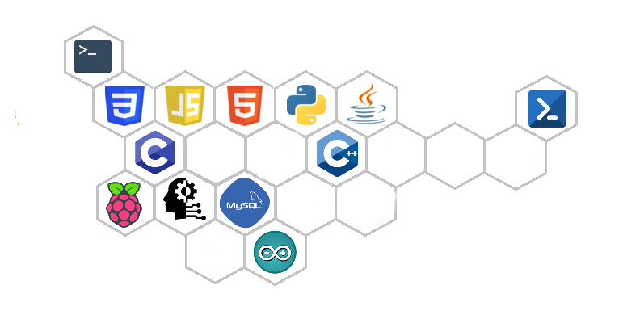

 <h1></h1>

  

  

- 💬 Ask me about **Data Science/AI/Web Development**
- 📝 I write articles on [brain Station 404!](https://brainstation10.blogspot.com/)
- 📷 I make videos on [Youtube](https://www.youtube.com/channel/UCJcScWVF3x1CLEg-XpvCXVw)

- ⚡ Fun fact **Love to learn , Think , Implement**

 
 
<h1></h1>
 
 <h3 align="left">Language, Framework and Topics:  </h3>
 
  

 

<h3 align="left">Online judge ID's:</h3>

 
    
    
     
 
 
    
     
    
    
    
     
    
    
  
    
    

 

  
 <h3 align="left">⚒  Integrated Development Environments - IDE's:</h3>

 
 
 
<!-- 

 -->

 
<h3 align="left">📱💻 Operating System:</h3>

 

 

 
<h1></h1>

   
 

 
